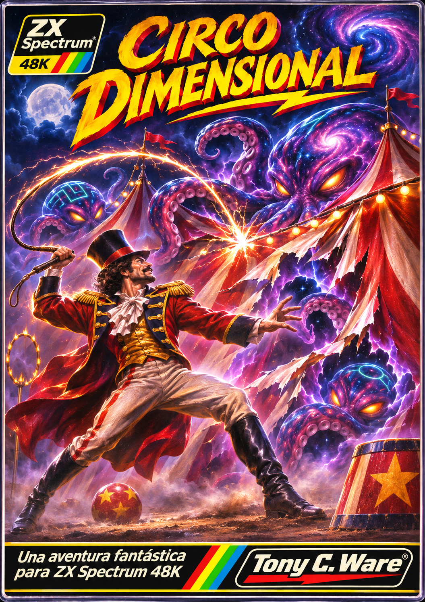
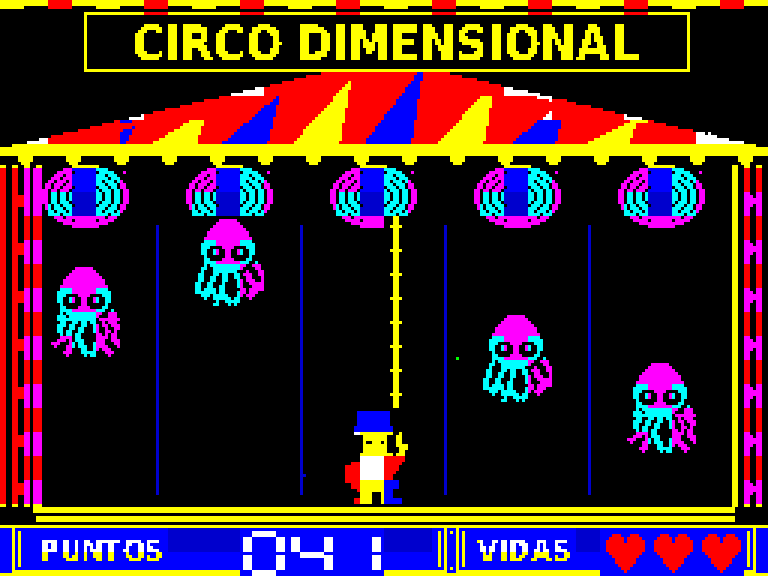

# 🎪 EL CIRCO DIMENSIONAL

**ZX Spectrum 48K · Edición definitiva v1.1 · © 2026 Tony C. Ware**



Un videojuego de reflejos inspirado en las primeras *Game & Watch*. Dom, el domador del Circo Europeo, debe detener los pulpos interdimensionales que entran en la carpa desde **cinco portales**.

## 🎮 Jugar

**[Descargar la Release oficial v1.1](https://github.com/OnRail76/Circo-Dimensional/releases/tag/v1.1)**

La [v1.0 original](https://github.com/OnRail76/Circo-Dimensional/releases/tag/v1.0) se conserva como versión histórica.

Descarga el archivo [CIRCO_DIMENSIONAL_48K_v1.1.tap](juego/CIRCO_DIMENSIONAL_48K_v1.1.tap), configura **Fuse** como ZX Spectrum 48K, carga la cinta y pulsa ESPACIO en la pantalla de título.

| Tecla | Acción |
| --- | --- |
| **O** | Avanzar exactamente un carril a la izquierda |
| **P** | Avanzar exactamente un carril a la derecha |
| **ESPACIO** | Latigazo energético |

**Control por toques:** mantener O o P pulsada **no** repite movimientos. Para avanzar otro carril, suelta y vuelve a pulsar.

Tres vidas, latigazo ilimitado, dificultad progresiva, escenarios coloridos y **sonido beeper** para Spectrum 48K.

**Novedades de v1.1:** tic corto por descenso de pulpos, GAME OVER visible al menos 5 segundos, **VS** amarillo en el título y dificultad ligeramente superior desde los cinco puntos.

## 📸 Capturas del juego

*Nota: las capturas de acción y los PDF ilustran el motor original; las novedades de v1.1 se documentan en las notas de lanzamiento.*


| Cuatro pulpos en acción | Latigazo visible |
| --- | --- |
|  |  |

*Las capturas de acción proceden de estados controlados del motor Z80 simulado. El juego también se probó de forma jugable en Fuse durante su desarrollo.*

## 🧹 Repositorio limpio y reconstrucción verificable

Solo se publican dos TAP en `juego/`: **v1.0 histórica** y **v1.1 definitiva**. Los resultados temporales del banco de trabajo ya no se versionan.

Para reconstruir y cotejar ambas versiones desde el motor original:

```bash
python3 -m pip install Pillow
python3 banco_de_trabajo/REBUILD_FINAL.py
```

La comparación es byte por byte e incluye comprobación SHA256. Consulta [cómo están organizadas las fuentes](fuente/README.md) y el [historial de limpieza](docs/HISTORIAL_Y_LIMPIEZA.md).

## 📚 Documentación y material de desarrollo

- [Manual en PDF](docs/Manual_Circo_Dimensional.pdf): historia de Dom, controles y pantallas.
- [Atlas Visual en PDF](docs/Atlas_Visual_Circo_Dimensional.pdf): diseños, arquitectura técnica, problemas corregidos y memoria del proyecto.
- [Fuente Z80 del motor base](fuente/CIRCO_NAVIDAD85_FINAL_2026.asm), con [parches y guía de construcción](fuente/README.md).
- [Banco de trabajo](banco_de_trabajo/README.md): generadores, recursos de pantalla y pruebas, sin TAP intermedios.
- [Carátula y otros diseños](arte/).
- [Capturas del juego](capturas/).
- [Notas de la Release v1.1](RELEASE_NOTES_v1.1.md).
- [Script de reconstrucción exacta v1.1](publicacion/v1_1/reconstruir_v1_1.py).

## ⚙️ Especificaciones

- **Plataforma:** ZX Spectrum 48K.
- **CPU:** Z80; juego en código máquina.
- **Vídeo:** 256 × 192 píxeles, colores Spectrum.
- **Sonido:** beeper 48K.
- **Presentación:** crédito «2026 Tony C. Ware».
- **Movimiento:** cinco carriles con controles por pulsaciones.

## ✍️ Autoría

**Idea, dirección creativa, diseño, pruebas en Fuse y decisiones finales: Tony C. Ware.**

Programación, gráficos del juego y documentación desarrollados iterativamente en colaboración con ChatGPT, siguiendo las pruebas y decisiones del creador.

## ⚖️ Licencias y derechos

- **Código Z80, scripts y pruebas:** **[Licencia MIT](LICENSE)**. Se pueden usar, modificar, redistribuir y comercializar con el aviso de copyright y el texto MIT.
- **Carátula, logotipo, sprites, fondos, pantallas y capturas:** **derechos reservados**, salvo autorización específica. Consulta [LICENCIA_GRAFICOS.md](LICENCIA_GRAFICOS.md).
- **TAP y PDF:** incorporan código y gráficos; el carácter MIT del código no implica que las ilustraciones también sean MIT. Consulta [DERECHOS.md](DERECHOS.md).

**© 2026 Tony C. Ware.**
